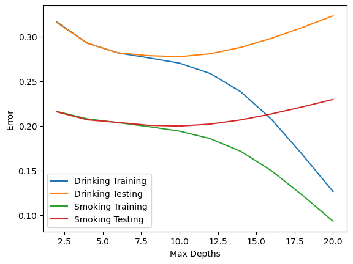
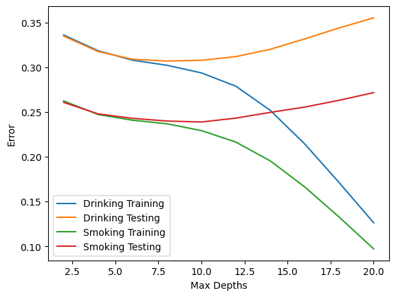
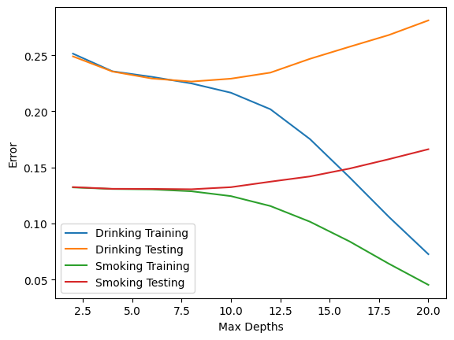
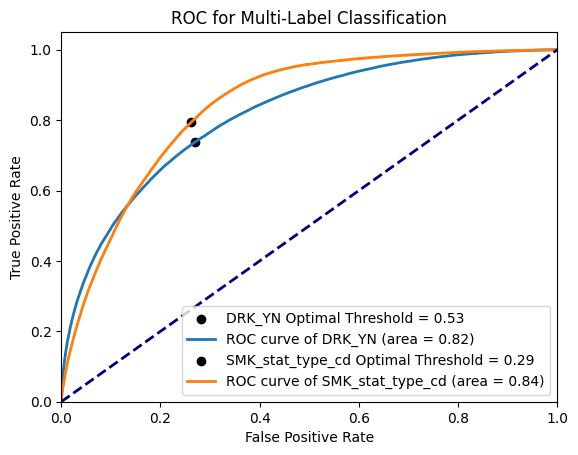
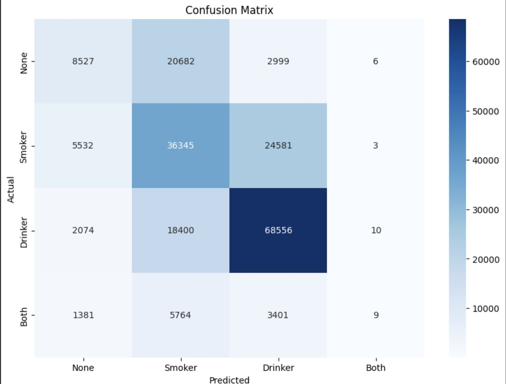

# Health Indicator Classifier: Smoker, Drinker, or Both?

Can routine health-screening measurements (blood pressure, cholesterol, liver enzymes, hemoglobin, and so on) tell whether someone **smokes**, **drinks**, or **both**? This project compares several classifiers on nearly a million anonymized health-screening records.

Built for DS 4400 *Machine Learning and Data Mining 1* at Northeastern University (Spring 2024).

> **Note on AI use:** Claude (an AI assistant) was used only to turn the finished project into a presentable GitHub repository. That meant organizing the files, writing this README, and pointing the notebook at the `data/` folder. All of the project work itself (data preprocessing, modeling, analysis and the presentation) was done without AI.

---

## Problem

| Aspect | Details |
|---|---|
| **Dataset** | [Smoking and Drinking Dataset with body signal](https://www.kaggle.com/datasets/sooyoungher/smoking-drinking-dataset): ~991k records from the National Health Insurance Service in Korea |
| **Targets** | Drinking status (`DRK_YN`) and smoking status (`SMK_stat_type_cd`), each binary |
| **Features** | Sex, age, height, weight, waistline, eyesight (L/R), hearing (L/R), systolic/diastolic blood pressure, fasting blood glucose, total/HDL/LDL cholesterol, triglycerides, hemoglobin, urine protein, serum creatinine, AST, ALT, γ-GTP |
| **Preprocessing** | Continuous features standardized (z-scores); categorical features encoded as integers |
| **Split** | 75% train / 25% test (`random_state=21`) |

The targets were modeled in two ways:
1. **Jointly**, as a multi-label problem that predicts both labels at once.
2. **Independently**, as two binary problems: *drinker?* and *smoker?*. The two predictions are then combined into *None / Smoker / Drinker / Both*.

The decision tree and Naive Bayes models were also trained separately on two age groups, **50 and under** and **above 50**, to see whether the signals differ by age.

## Models

| Model | Setup |
|---|---|
| Logistic Regression | One-vs-Rest multi-label model (L1 and L2 penalties), plus two independent binary models |
| Decision Tree | `max_depth` tuned over 2–20 using train/test error curves |
| Gaussian Naive Bayes | Default settings |
| Neural Network | Feed-forward network (22 → 12 → 2, ReLU hidden layers, sigmoid outputs), binary cross-entropy loss, SGD (lr 0.01, momentum 0.9), with per-target thresholds chosen from the ROC curves |

## Results (test set)

### Best of each model, all ages

| Model | Drinker: Accuracy | Drinker: F1 | Drinker: AUC | Smoker: Accuracy | Smoker: F1 | Smoker: AUC |
|---|---|---|---|---|---|---|
| Logistic Regression (independent) | 0.722 | 0.72 | 0.722 | 0.796 | 0.33 | 0.592 |
| Decision Tree (depth 10) | 0.723 | 0.727 | 0.723 | 0.800 | 0.380 | 0.613 |
| Naive Bayes | 0.686 | 0.681 | – | 0.722* | 0.516* | – |
| **Neural Network** | **0.734** | **0.737** | **0.815** | 0.746 | **0.579** | **0.841** |

The neural network gives the best overall balance. Its AUC is highest for both targets, and its smoker F1 is much higher than the other models', because the tuned threshold trades some accuracy for much better recall (0.81) on the minority "smoker" class. The joint multi-label logistic regression got both labels right for only 57.2% of records (AUC 0.657). When the independent logistic models are combined into four categories, they almost never predict *Both* (28 times out of ~198k test records).

\* See [Known limitations](#known-limitations).

### Effect of age (decision tree and Naive Bayes)

| Subset | DT Drinker: Accuracy / F1 / AUC | DT Smoker: Accuracy / F1 / AUC | NB Drinker: Accuracy / F1 | NB Smoker: Accuracy / F1 |
|---|---|---|---|---|
| All ages | 0.723 / 0.727 / 0.723 | 0.800 / 0.380 / 0.613 | 0.686 / 0.681 | 0.722 / 0.516 |
| 50 and under | 0.693 / 0.754 / 0.670 | 0.761 / 0.461 / 0.641 | 0.652 / 0.688 | 0.691 / 0.552 |
| Above 50 | 0.773 / 0.625 / 0.722 | 0.869 / 0.130 / 0.532 | 0.738 / 0.618 | 0.793 / 0.361 |

In the over-50 group the smoker accuracy is high (0.87) but the F1 is very low (0.13). Few older people in the data smoke, so the model mostly predicts "non-smoker". Accuracy alone is misleading on this target.

<p align="center">
  
  
  
  <br><em>Decision tree train/test error vs. max depth (all ages, 50 and under, above 50). Test error is lowest around depth 8–10, and deeper trees overfit.</em>
</p>

<p align="center">
  
  
  <br><em>Left: neural network ROC curves with the chosen thresholds. Right: confusion matrix of the independent logistic regression models, combined into None / Smoker / Drinker / Both.</em>
</p>

## Repository layout

```
├── notebooks/
│   └── decision_trees_and_naive_bayes.ipynb   decision tree and Naive Bayes experiments (with outputs)
├── data/
│   └── README.md                              where to get the data and the expected CSV files
├── docs/
│   ├── presentation.pdf                       final project presentation (all models)
│   └── images/                                figures used in this README
└── requirements.txt
```

## Running

```bash
pip install -r requirements.txt
# place the preprocessed CSVs in data/ (see data/README.md)
jupyter notebook notebooks/decision_trees_and_naive_bayes.ipynb
```

## Known limitations
- **Naive Bayes, smoking target:** the smoking model is fit on the *test* split and evaluated on that same split (`gnb.fit(X_test_smoking, ...)`), so its smoking scores are optimistic. The drinking model is trained and tested correctly.
- **AUC for the decision tree and logistic regression** is computed from hard class predictions, not predicted probabilities, so it understates what those models could reach. The neural-network AUC uses probabilities.
- The preprocessing code and the scaled CSVs are not included. `data/README.md` describes the expected files.

## Acknowledgements
This was a team project with three members, and the full team's results are in [`docs/presentation.pdf`](docs/presentation.pdf). The notebook in this repository contains my part: the decision tree and Naive Bayes experiments. The logistic regression and neural-network results come from the presentation.
